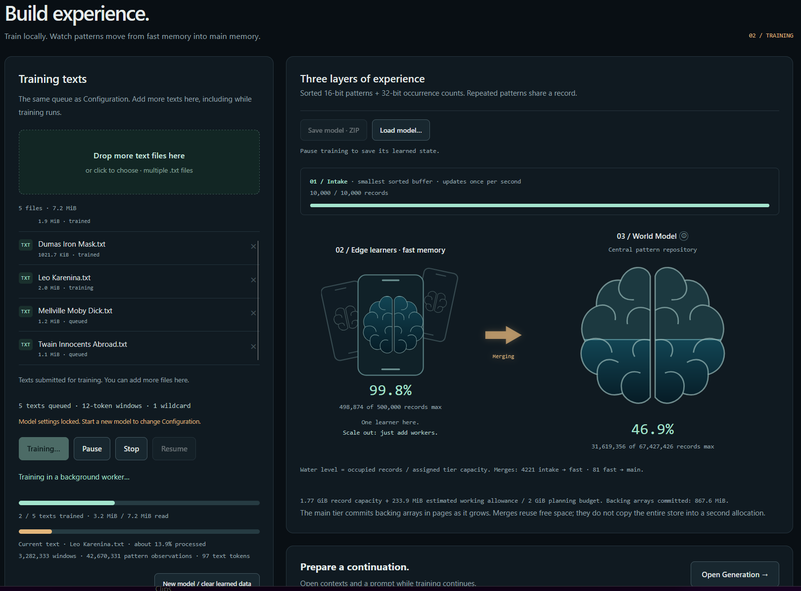

# Clue 10 — Context Reranking Lab

**[Open the live experiment](https://masteralgo.github.io/clue10/)**

An experiment in **symbolic pattern populations**.

Feed the browser some text. Let it accumulate recurring sequences. Then give the learned population a prompt and optional contexts, and watch how the next-token candidates are ranked.

No neural network, no server, no installation.

*Training in progress — edge learners accumulate and merge patterns into the World Model.*

## Try it

1. **Configure** — Add plain `.txt` files. Choose token size, pattern length, and wildcard allowance.
2. **Train** — Build the pattern population. Watch the edge learner and World Model fill; you can add more texts while training.
3. **Generate** — Enter a prompt. Consider or ignore any of three contexts. Compare *most*, *least*, *middle*, and *random* candidate-selection modes. Inspect candidates and context-colored output.
4. **Keep your experience** — Pause or finish training, then **Save model · ZIP**. Use **Load model** to continue another time, without reloading the original texts.

## What is happening?

Stored sequences supply the continuation candidates through exact matching. Considered contexts rerank those candidates by mean cosine similarity; the frequency mode breaks ties.

The point is to make the influence of context *visible and experimental*, rather than hide it behind a generated paragraph.

## Notes

- The experiment runs locally in your browser. Your training texts and learned models are **not uploaded**.
- Saving a model exports the learned state to a ZIP file. Loading a model **replaces** the currently loaded model and training queue.
- Memory use and performance depend on the browser, device, and size of the pattern population.
- The application is self-contained in [`index.html`](index.html). No build process or third-party libraries are needed.

**Clue 10 is an experiment, not a chatbot.**
